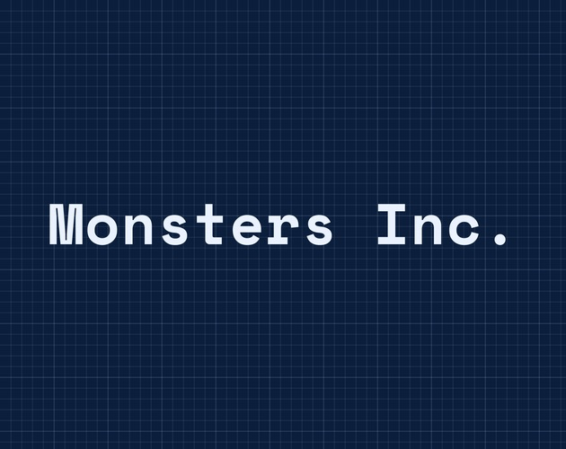
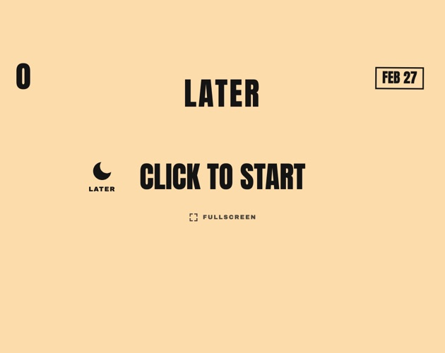
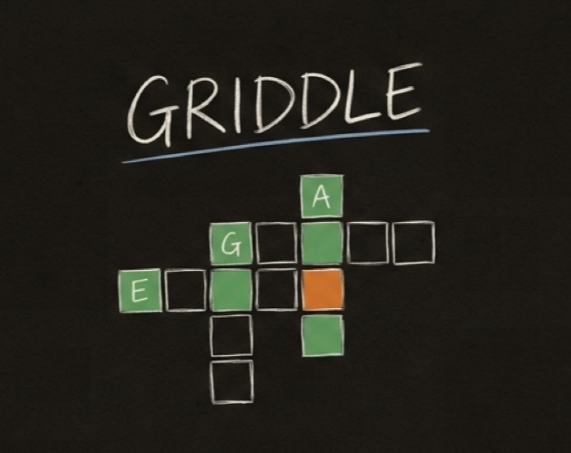
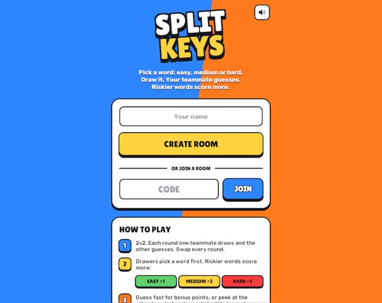
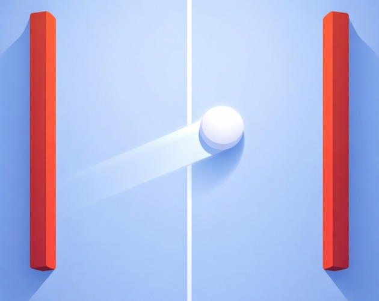
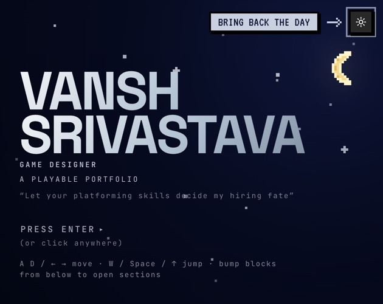

<h1 align="center">Vansh Srivastava</h1>

<b>Game designer.</b> I design worlds you can play with.

  <a href="https://whenom-interactive.vercel.app">Playable portfolio</a> ·
  <a href="https://whenommm.itch.io">itch.io</a> ·
  <a href="https://www.linkedin.com/in/vansh-srivastava-whenom/">LinkedIn</a> ·
  <a href="https://x.com/whenommm">X</a> ·
  <a href="mailto:vanshsrivastavaqa@gmail.com">Email</a>

Every game I make starts with the player: what should they feel, and what should they do to get there? I design toward that answer, from the core mechanic and the rules to the levels and the ending, then play it over and over, tuning until the game gets there on its own.

AI writes most of my code. That leaves my time for the parts that make a game: what you're asked to do, how hard it gets, and how it *feels*.

**Open to game design internships**, remote or in Bengaluru.

## Games

<table>
  <tr>
    <td width="33%" valign="top">
      
      <h3><a href="https://whenommm.itch.io/monsters-inc">Monsters Inc.</a></h3>
      Block-pushing puzzle meets tower defense: stop closet monsters reaching your bed with toy blocks and wall outlets. Ten rooms, one exact solution each.  
      <b>#43 of 207</b> at Bezi Mega Jam 2026, #25 for Scope &amp; Completion. Solo.
    </td>
    <td width="33%" valign="top">
      
      <h3><a href="https://whenommm.itch.io/later">Later</a></h3>
      A 20-second dodge game whose last seconds change what you've been doing all along. Three endings shaped by your choices.  
      Made overnight for 20 Second Game Jam 2026.
    </td>
    <td width="33%" valign="top">
      
      <h3><a href="https://whenommm.itch.io/playgriddle">Griddle</a></h3>
      A crossword with no clues: guess words Wordle-style, and every solve reveals a rule true of the whole grid.  
      20-level campaign, a daily puzzle with streaks, and endless generated grids.
    </td>
  </tr>
  <tr>
    <td width="33%" valign="top">
      
      <h3><a href="https://split-keys.onrender.com">Split Keys</a></h3>
      A 2v2 draw-and-guess party game in the browser. Pick how risky your word is first: hard words score triple, but cost you if nobody gets them. Steal the other team's word if you can read their drawing.  
      Online multiplayer, phones and laptops.
    </td>
    <td width="33%" valign="top">
      
      <h3><a href="https://whenommm.itch.io/pongping">PongPing</a></h3>
      Pong turned inside out: you play the ball, not the paddles, and every hit shrinks the paddle that took it.  
      <b>#120 of 517</b> for Enjoyment at Bad Ideas Game Jam 2026. Solo.
    </td>
    <td width="33%" valign="top">
      
      <h3><a href="https://whenom-interactive.vercel.app">Playable portfolio</a></h3>
      My portfolio is a pixel platformer: bump the question blocks from below to open each page. Day and night themes.  
      Phaser 4 and React.
    </td>
  </tr>
</table>

**More designs**

- [**Blind Command**](https://github.com/whenommmm/blind-command): a deduction game for Brackeys Game Jam 2026 (theme: *Trust No One*). You command a bunker you never see, through the radio reports of three informants, and one of them is lying. [Design doc](https://github.com/whenommmm/blind-command/blob/main/docs/GDD.md).
- [**Input Lag**](https://github.com/whenommmm/Input-Lag): a puzzle platformer for GMTK Game Jam (theme: *Count Down*). Walking is instant, but every jump and dash fires after a delay, so you program your future moves.
- [**FallingBlocks**](https://whenommmm.github.io/falling-blocks-build/), [**SphereRunner**](https://github.com/whenommmm/SphereRunner) and [**WorldOfShadows**](https://gd.games/games/52c558b6-0bc4-4209-bfc3-84e4d6da34fe): my first games, made while learning Unity and GDevelop.

## How I design

- **Write it down, then make it playable.** Each game starts as a design doc: the feeling I'm after, the core loop, the rules. Then comes a rough playable mockup that I test and refine before the real build.
- **Prove it's fair.** I use simulated players to check a design before real players do. Bots confirm every pill in Later can be dodged, a solver bot sets par for each Griddle level, and Blind Command's balance is checked across 600 simulated runs.
- **Let players plan, not guess.** Monsters Inc. shows every room's full monster schedule up front and allows unlimited undo, so trying an idea costs nothing.
- **Playtest, then tune.** I tested pre-release builds of *The Space Between* for Subatomic Forge Studios, reporting friction, balance and bugs, and I'm named in its credits.

## Toolkit

**Engines:** Unity, Phaser, GDevelop, Unreal Engine ·
**Building with AI:** Claude Code ·
**Shipping:** WebGL, itch.io, Vercel, Git and GitHub ·
**Art and UI:** Photopea, Canva

## Education

**Scaler School of Technology**, Bengaluru. Studying for a B.Sc. in Computer Science, awarded by BITS Pilani through its online programme (2024–2028).
